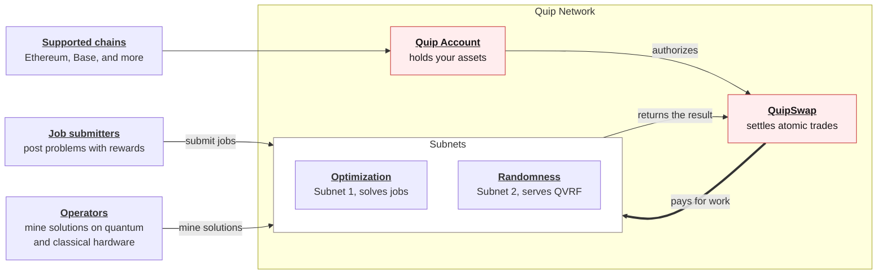
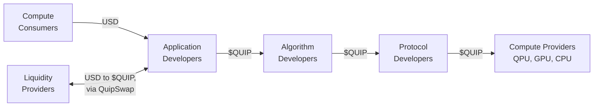

# How Quip Network Fits Together

Quip is easiest to understand as a chain of four pieces, where each piece exists because of the one before it. This page walks that chain once, and every other page in this section covers one link in depth.

## The four pieces

1. **The Quantum Unit Interlock Pathway (QUIP) is the primitive.** A lockbox that releases funds only against a post-quantum signature. Everything else is built on it. See [QUIP: The Quantum Unit Interlock Pathway](/docs/quip-interlock-protocol/quip-the-quantum-unit-interlock-pathway).
2. **A Quip Account is that lockbox, holding your assets.** It lives on the chain you already use (Ethereum, Base, and others), so you get post-quantum protection without moving anything. See [Quip Accounts](/docs/quip-interlock-protocol/quip-accounts).
3. **QuipSwap lets two accounts trade atomically.** One shared secret settles both sides of a trade, or neither. Because that works across chains, value can move without a bridge. See [QuipSwap](/docs/quip-interlock-protocol/quipswap).
4. **That same swap mechanism pays for quantum compute.** Operators are paid through the swap, so you can request work from whatever chain your assets are on. Quantum randomness is designed to be the first product sold this way. See [Quantum Randomness (QVRF)](/docs/compute/qvrf).

## The whole system in one diagram

The account and swap contracts are deployed onto the supported chains themselves, so your assets never leave the chain they live on. QuipSwap's trades are sealed by the QUIP interlock, the shared-secret construction the protocol is named for; [QUIP: The Quantum Unit Interlock Pathway](/docs/quip-interlock-protocol/quip-the-quantum-unit-interlock-pathway) explains it.

Unlike most Web3 platforms, Quip's atomic swaps require no bridge. The swap carries the value between chains, so there is no bridge for anyone to attack and no third-party bridge contract for Quip to depend on.

## Who pays whom

The network is a stack of participants, and every payment between layers settles the same way.

Every $QUIP hop is a payment for work one layer down, and cross-chain payments settle over the QuipSwap protocol.

## Where to go next

| If you want to | Read |
| --- | --- |
| Hold assets under post-quantum protection | [Quip Accounts](/docs/quip-interlock-protocol/quip-accounts) |
| Trade without bridges | [QuipSwap](/docs/quip-interlock-protocol/quipswap) |
| Buy quantum randomness | [Quantum Randomness (QVRF)](/docs/compute/qvrf) |
| Submit an optimization job | [Submit Your First Compute Job](/docs/compute/submit-a-job) |
| Run hardware and earn | [Run A Node](/docs/nodes/run-a-node-testnet) |
