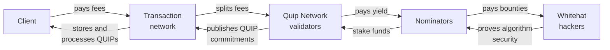

# Participants

## Distributed Compute Protocol

Many different consumers, developers, operators, and liquidity providers come together to participate in the Quip Network. Each serves an irreplaceable function in the whole of the protocol.

<figure><picture><source type="image/webp" srcset="/docs/assets/stakeholder-categories-2.webp"></picture><figcaption>
The different participants in the compute protocol
</figcaption></figure>

| Payor                 | Payee                 | Request                                                           |
| --------------------- | --------------------- | ----------------------------------------------------------------- |
| Consumer              | Application Developer | Upload data and bid for solver execution                          |
| Application Developer | Algorithm Developer   | Convert consumer bid currencies and format data for chosen solver |
| Algorithm Developer   | Protocol Developer    | Extract, transform, load data for optimal solver architecture     |
| Protocol Developers   | Compute Providers     | Route transformed data to the optimal architecture                |
| Compute Providers     | Liquidity Providers   | Execute the requested job for compute credits                     |
| Liquidity Providers   | Consumer              | Sell compute credits for local stable currencies                  |

### Consumers
Consumers may be individuals, small businesses, or enterprises. No matter who they are, they're looking to get better answers out of their compute solutions, whether that is a 9-figure cluster of GPUs or Jenny from operations down the hall.

Whoever they are, it's unlikely that they have a lot of expertise in quantum computing, and so they need a lot of help to connect to the right solvers for problems in their industry. The best way for this to happen is that someone identifies edge that can be achieved with a quantum computer and packages that into an app. The second best way is that these quantum curious people can browse a library of solvers and use a no-code API to try them out.

The only thing they should have to worry about is how much they are willing to pay in their home currrency to access a solution. Everything else should be handled by the network.

### Application Developers
As with traditional application developers, middleware providers for the Quip Network may come from their industry of focus and have slightly more technical savvy than their average colleague. Or, they saw an opportunity and hired consultants to help them exploit it.

No matter where they come from, they tend to be entrepreneurs or enterprises trying to package a compute resource into a repeatable billable. Their goal is to find edge in their industry by using the network, and resell that edge to their customers.

The most important thing from the network's perspective is to make it easy to discover applications, format consumer data, request jobs, acquire the tokens expected by the smart contract developer and the protocol, and exchange currencies on behalf of the end-consumer.

### Algorithm Developers
One layer down from the application developers, we have the algorithm developers. They promote job specifications to solve specific industrial challenges that matter to consumers, and then deploy smart contracts that solve those job specifications. They can charge fees in any currency for each execution of the contract.

A job specification consists of an input type, an output type, and a verification type that makes sure the output is a valid transformation of the input. Job specifications can be linked together in order to extract, transform, and load data for arbitrary workloads. Target hardware implementations can be associated with each specification.

When a job specification wants to rely on a Proof of Useful Work, the implementation can request the Protocol to serve the model for a block reward.

The network's role is to make this process of writing, deploying, and optimizing solvers easy and enjoyable, while abstracting away the more onerous aspects of fine-tuning results.

### Protocol Developers
Protocol developers maintain the network and submit parameters for every new Proof of Useful Work. Quantum computers exist in an odd complexity class where some of their outputs can be computed efficiently by classical computers (eg calculating Hamiltonian ground states), some can only be verified efficiently by classical computers (eg elliptic curve discrete logarithm problem), and some can only be verified by other quantum computers (eg quantum merlin-arthur problems).

Every solved block and every Proof of Useful Work provides a percentage of fees back to the network in order to fund its maintenance and improvement. Protocol developers also deploy new implementations for different hardware architectures so that Proofs of Useful Work can benefit from state of the art algorithmic improvements.

Here, the network's role is to make sure that the development of the subnets and new Proofs of Useful Work is always sufficiently incentivized, and to make this process of deploying new proofs easy with straightforward discoverability and interpretibility by the Compute Providers.

### Compute Providers
These operators of all kinds of computer processors do the hard work of actually solving smart contract bids and Useful Proofs of Work. They charge on a per instruction basis and accept larger bids to prioritize which jobs they will execute on their hardware.

Ultimately it is up to the operator to decide which types of jobs they will serve, the threshold for making that job attractive to execute, and what requirements they will need in a ZK credential before serving a consumer's bid. In many cases, it may make sense to form a mining pool that combines resources across hybrid platforms or multi-QPU clusters.

The protocol must focus on making it easy for compute providers to discover and toggle these features of the collective smart contract library, to benchmark their performance and expected payoff for mining any subnet, and to deny service based on the rules in their local jurisdiction.

### Liquidity Providers
An often under-appreciated participant in most networks, the job of the liquidity providers is to efficiently discover the price of the shared compute credit and to provide a liquid market between consumers' local currency and the network's native token.

For the most part, they should be interacting directly with developers and operators rather than consumers, but in some cases consumers may wish to monetize their inventory of compute credits by acting as a liquidity provider.

There are many unexplored roles for liquidity providers as well: building prediction markets for new valuable Proofs of Useful Work, voting protocol emissions to subnets based on their perceived relative value, and even providing sureties against the bad behavior of distributed identities in the network.

The most important thing is to make the token useful for more than just reserving compute and to make it easily exchangeable and bondable.

## Interlock Protocol

While QUIPs can be created and executed on a peer to peer basis, significant additional value will be created given a public index of all the active quips on various networks. As such, we endeavor to form the Quip Network, comprising several parties who collaborate to make the world a safer place to transact:

| Payor                   | Payee                   | Service                       |
| ----------------------- | ----------------------- | ----------------------------- |
| Client                  | Transaction Network     | Store & Process QUIPs         |
| Transaction Network     | Quip Network Validators | PubSub QUIP Commitments       |
| Quip Network Validators | Nominators              | Endorses via Staked Assets    |
| Nominators              | Whitehat Hackers        | Proves Security of Algorithms |

### Clients
Clients come in many shapes and sizes, from retail to institutional, as lenders, traders, insurers, and end-users of the underlying protocol. To take advantage of a QUIP, they pay fees for the necessary computation and storage on the underlying transaction network and the QUIP extension will determine any additional fee retained by the protocol. Wallet providers and treasury management solutions may wish to integrate QUIPs as a secure add-on for their clients, in order to streamline the process of forming and executing more complex QUIP exchanges.

Institutions may wish to employ QUIPs as a second layer of security on their cold storage funds, or else integrate QUIPs directly into low volume hot wallet transactions that touch more sensitive and valuable assets. Even transaction networks with highly sensitive contracts, such as Ethereum’s validator staking contract that holds more than 45% of all ETH, may wish to integrate a QUIP directly into the contract so that stakers can rest secure in the knowledge their funds are safe.

### Transaction Networks
Transaction networks don’t have to explicitly form partnerships with the Quip Network, as any deployer can post a QUIP-enabled smart contract or cryptographic primitive to any sufficiently sophisticated network. However, protocols and traditional payment rails may wish to subscribe to the Quip Network’s validators and create a plan for restoring a canonical chain state in the event of a significant reorganization by a quantum attacker.

If the Quip Validators are unable to show that certain accepted post-quantum signatures are still included in the heaviest block or tip of any network, it is a signal that the network may have been compromised by a quantum attacker. Such an eventuality can be planned for, and the miners or validators can adopt a set of criteria for rejecting chain states that do not include recent QUIP commitments.

### Validators
In addition to the developers and the foundation, the Quip Network will employ Nominated Proof of Stake Validators to maintain and upgrade services for any transaction network that has not yet implemented post-quantum security, and to provide automation to individual depositors and clients who do not wish to directly manage the Quip Protocol on a peer-to-peer basis. Alongside the miners who solve Proofs of Useful Work and broadcast winning blocks, validators are one of the three consensus roles — validators, miners, and nominators — that receive the $QUIP token for running the chain.

A validator is a full node. These infrastructure providers maintain indices of all proposed quips and process messages and transactions between willing counter-parties in return for $QUIP. They can aggregate together multiparty quip transaction signatures and batch the processing for cost savings, provide mixnet or privacy-preserving functionality, and execute other post-quantum multi-party computation services. In return for locking up funds on target networks to facilitate liquidity and collateral, these node providers receive yield in the form of network fees on the indexed networks, as well as $QUIP emissions.

Validators also track the current state of each host transaction network to ensure that no quip has been orphaned by a block reorganization or other malicious attack on consensus. These records can be used by host networks as a canonical checkpoint in case of a rewind attack by a quantum attacker — the commitment-omission defense — and can improve the security of the underlying transaction network. Storing and attesting the presence of quips on host networks earns attestation fees on top of emissions.

For enterprising node providers with insufficient funds to meet the minimum bond required of a trusted validator, they can accept stakes from nominators and share yield from validation.

### Nominators
Nominators can supply funds to validators with insufficient capital to meet the minimum stake, and can restake the coupon and yield tokens as collateral for further Quip Network activity.

An added bonus of the validator and nominator staking structure is that node providers can choose the post-quantum algorithms that they trust most to protect their own funds, and nominators can choose the validators using the post-quantum algorithms they trust most.

This stakers’ collective choice of post-quantum algorithm will provide an implicit betting market on the safety, storage, and throughput tradeoffs of each paradigm, which can incentivize quantum attackers to prove that any given post-quantum algorithm is flawed. The protocol will provide a built-in bug bounty mechanism, where a quantum attacker can reveal the private information necessary to slash validator and nominator stakes to keep a percentage of the compromised funds. Some percentage of this stake will also be used to stake a bug bounty showing that ECC256 has been broken, and that quantum supremacy has arrived.

### Whitehats
Arguably one of the most important participants in the network, these enterprising cryptographers and computer scientists can earn automated bug bounties for showing that existing cryptography is now insecure to contemporary methods. By using vulnerabilities in classical and post-quantum algorithms to reveal private keys, they can slash the stake of all the existing validators and nominators and prove that a given algorithm is no longer secure.

This activity creates a more resilient ecosystem of decentralized services, and will increase demand for the security guarantees provided by the Quip Network and the remaining secure algorithms. The more any one algorithm is preferred by the validators, the larger incentive remains for a white hat to claim their pro rata share of the stake.

The $QUIP token these participants earn and spend is described in [Token](/docs/network/token), and the properties the network has to hold to for them is set out in [Key Properties](/docs/basics/key-properties).
